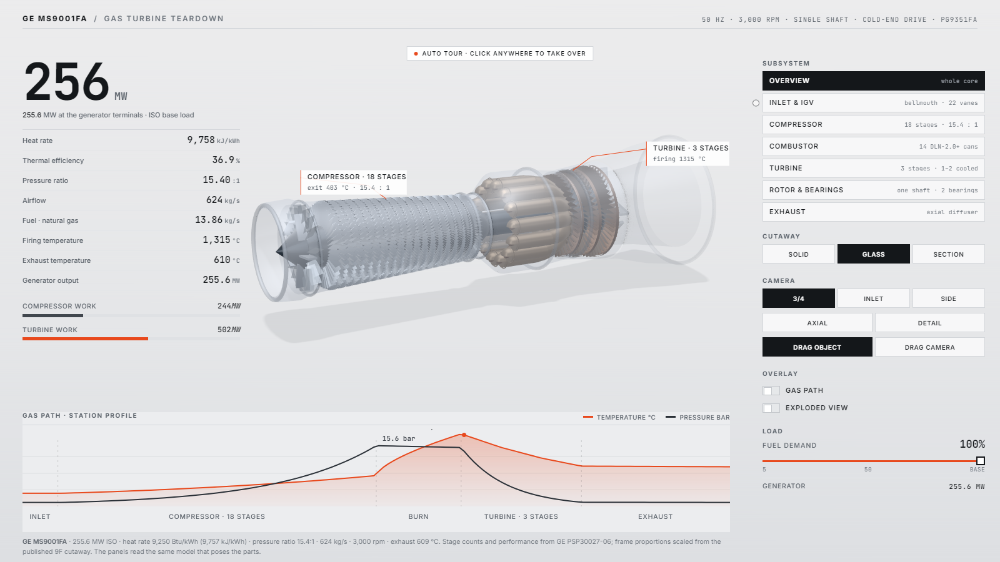
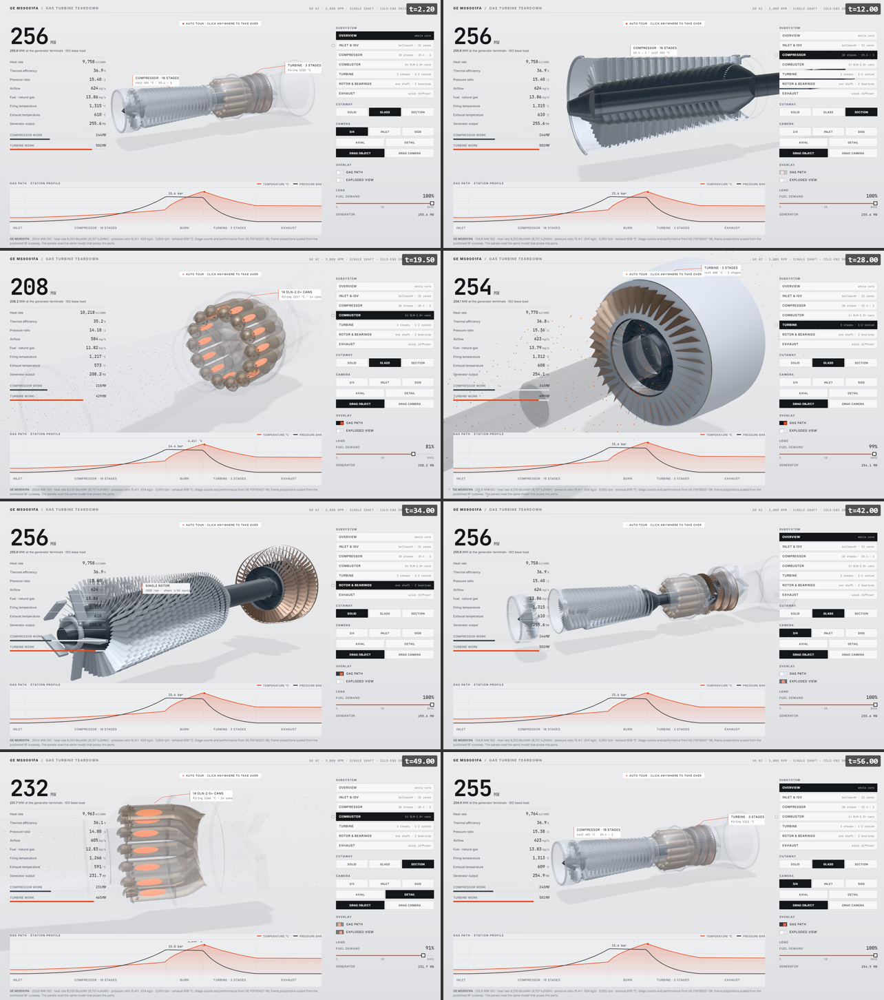

# GE MS9001FA — gas turbine teardown

An interactive 3D cutaway of the GE **MS9001FA** (PG9351FA), the 50 Hz heavy-duty, single-shaft gas
turbine — compressor, cans, turbine and rotor, on one offline HTML page you can take apart.

**▶ Play: https://mpsmeridian.github.io/ms9001fa-teardown/**

[](https://mpsmeridian.github.io/ms9001fa-teardown/)

The core sits in the middle and runs. Every panel around it reads the same load state that poses the
parts, so a gauge can never disagree with the flame beside it. Left alone the page plays a 60 s tour that
presses its own buttons; a click, drag, wheel or key hands control over, and 25 s of quiet hands it back.



## Controls

| Control | What it does |
|---|---|
| **Subsystems** | OVERVIEW, INLET & IGV, COMPRESSOR, COMBUSTOR, TURBINE, ROTOR & BEARINGS, EXHAUST — isolates the part, moves the camera, shows a callout |
| **Cutaway** | SOLID (as built), GLASS (casings see-through), SECTION (near half clipped away) |
| **Camera** | 3/4, INLET, SIDE, AXIAL, DETAIL |
| **Drag mode** | DRAG OBJECT (default, the part follows your finger) or DRAG CAMERA (both axes inverted); remembered per browser |
| **Overlays** | GAS PATH (flow particles coloured by station temperature), EXPLODED VIEW (axial spread) |
| **Load** | fuel demand 5–100 % |
| Keys | `1`–`5` cameras, `G` gas path, `E` explode, `I` invert drag, `H` hide overlay, arrows load |

Drag to orbit, wheel to zoom, or just watch. Rotor motion is shown at 1/50 of the real 3,000 rpm.

Two compositions, not one squeezed: a 1600 × 900 console around the machine on landscape screens, and a
portrait stack in real CSS pixels on phones — 44 px targets, the station chart gives way to the machine and
the controls. Every control is a real `<button>` or `<input type="range">`, so Tab reaches them, Enter and
Space activate, and the focus ring is the accent. `prefers-reduced-motion` stops the tour from starting.

## The machine

| | |
|---|---|
| Output, ISO | 255.6 MW |
| Heat rate | 9,250 Btu/kWh = 9,757 kJ/kWh |
| Pressure ratio | 15.4 : 1 |
| Airflow | 1,375 lb/s = 624 kg/s |
| Speed | 3,000 rpm (50 Hz) |
| Exhaust temperature | 1,129 °F = 609 °C |
| Compressor | 18 stages + 2 exit guide vanes |
| Combustor | 14 can-annular, DLN-2.0+ |
| Turbine | 3 stages, stage 1–2 buckets air-cooled |

Source: GE's MS9001FA product sheet (PSP30027-06) and the published 9FA configuration description.
`gt9fa/spec.js` is the only place those numbers live: one input (load) drives pressure ratio, firing
temperature, airflow, the expansion, fuel flow and every station of the chart. At base load the model
reproduces the datasheet heat rate and exhaust temperature (9,758 kJ/kWh, 36.9 %, 609 °C).

Frame proportions — 11.8 m core, 2.1 m compressor casing, 2.4 m turbine wheel — are scaled from the
public 9F cutaway, not from an OEM drawing; the firing temperature is the F-class class figure (≈1,315 °C).
If you have real drawings, the parameter block in `gt9fa/machine.js` is where they go.

## Build

The page is built by the [`teardown`](https://github.com/elvarofficial/teardown) skill, which is not
vendored in this repo.

```
git clone https://github.com/elvarofficial/teardown %USERPROFILE%\.config\opencode\skills\teardown
cd %USERPROFILE%\.config\opencode\skills\teardown && npm install && npx playwright install chromium
```

Then, from this repo:

```
node build.mjs          # → index.html, the one file GitHub Pages serves
```

`TEARDOWN_SKILL=/path/to/teardown` overrides where the skill is looked up. `site.json` holds the public
URL used for the Open Graph image; leave it empty to build without absolute meta tags.

| File | Job |
|---|---|
| `index.html` | the built page — self-contained, ~820 KB, no external requests |
| `gt9fa/spec.js` | datasheet constants + the gas path model |
| `gt9fa/machine.js` | geometry: bellmouth, 18 stages, 14 cans, 3 turbine stages, rotor, bearings, exhaust |
| `gt9fa/stage.js` | studio, lights, shadows, ambient occlusion, camera |
| `gt9fa/console.js` | overlay: panels, station chart, callouts, buttons |
| `gt9fa/live.js` | interaction, cameras, the auto tour, the frame loop |
| `gt9fa/main.js` | entry point |

GitHub Pages serves `main` / root as-is, so there is no CI step: commit `index.html` and the site is live.

## Licence

MIT for this project. The teardown kit, frame capture and review rules come from
[whaleyxbt/claude-motion](https://github.com/whaleyxbt/claude-motion) (MIT); the teardown skill is
[elvarofficial/teardown](https://github.com/elvarofficial/teardown) (MIT). MS9001FA is a GE Vernova
product; this is an independent visual explainer, not affiliated with or endorsed by GE.
